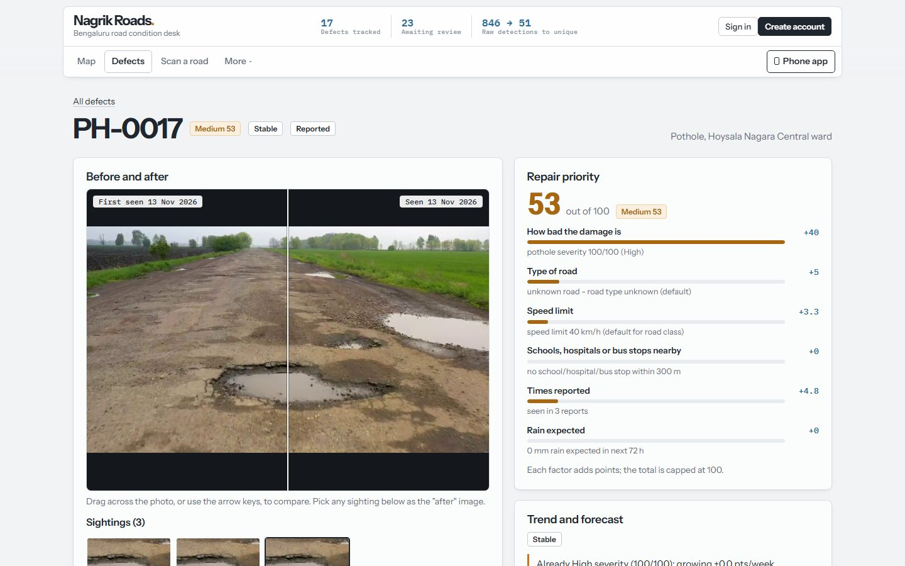
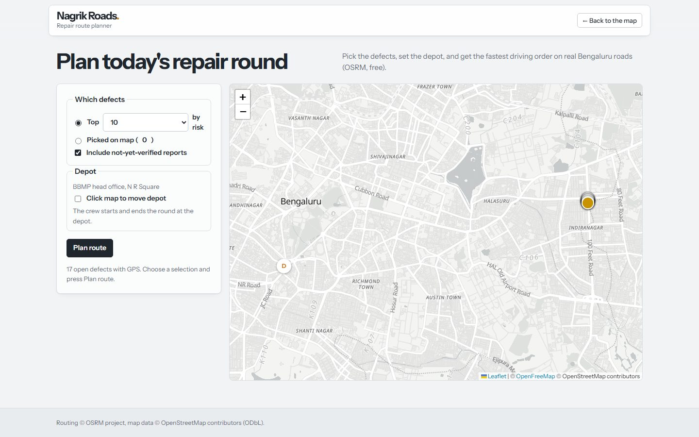
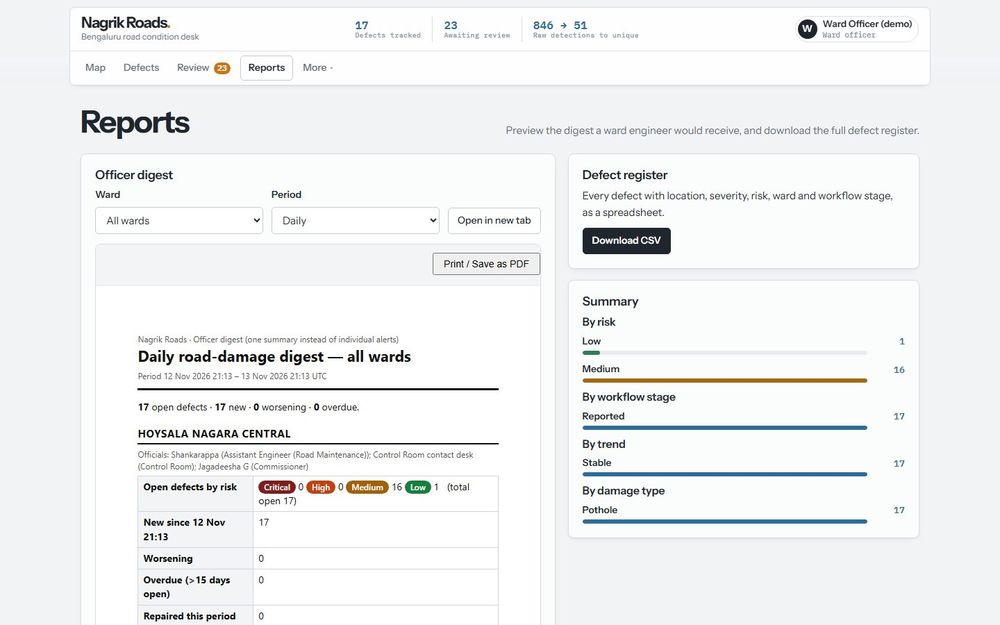
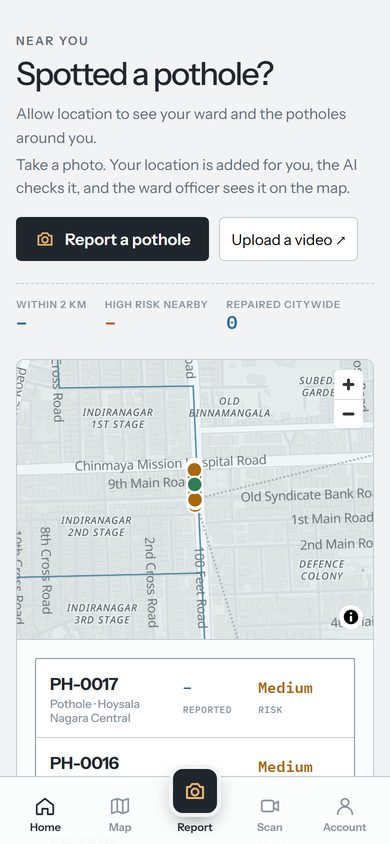
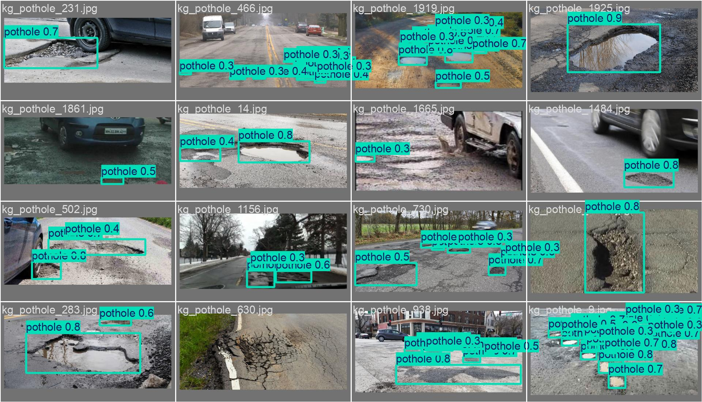
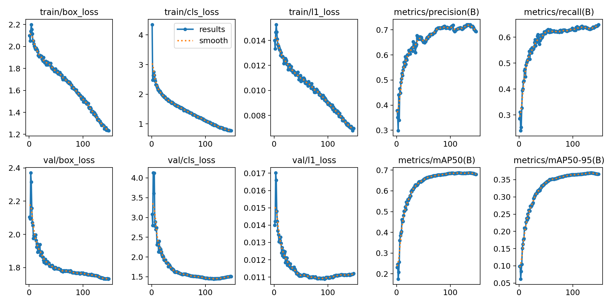

<div align="center">


# Nagrik Roads

### Every pothole, seen once. Fixed first.

AI road-damage detection for Bengaluru. A phone or dashcam records the road, the AI finds every pothole and crack,
counts each one once, ranks it by danger and sends it to the ward officer responsible, then checks that the repair
really happened.

**Built for HackValley 2K26 · Problem statement PS 02: AI-Based Road Damage and Pothole Detection System**

  

     

### 🌐 Live demo: **[nagrik-roads.vercel.app/roads](https://nagrik-roads.vercel.app/roads/)**

| | Live link |
|---|---|
| Nagrik Roads (website + phone app) | https://nagrik-roads.vercel.app/roads/ |
| Officials' dashboard and map | https://nagrik-roads.vercel.app/roads/dashboard |
| Live scan (phone camera) | https://nagrik-roads.vercel.app/roads/live |
| Model training results | https://nagrik-roads.vercel.app/roads/training |
| Nagrik city site | https://nagrik-roads.vercel.app/ |
| AI backend (Hugging Face Space) | https://huggingface.co/spaces/ayman43/nagrik-roads-backend |
| API health check | https://nagrik-roads.vercel.app/api/health |

<sub>Website on Vercel · AI backend on Hugging Face · open the Roads link on a phone and tap <b>Install app</b> (iPhone: Share → Add to Home Screen). The free backend sleeps when idle: the first visit can take a minute.</sub>

[Features](#features) · [Screenshots](#screenshots) · [Results](#results) · [PS 02 checklist](#ps-02-checklist) · [Run it](#run-it) · [How it works](#how-it-works)


</div>

---

## The problem

- **Potholes are found late.** Cities rely on complaints, so damage on quiet roads goes unreported until it is dangerous.
- **The same pothole is reported again and again.** Ten complaints about one pothole look like ten problems.
- **Nobody knows which one to fix first.** A small crack outside a school matters more than a big one on an empty lane.
- **Bad repairs go unnoticed.** A pothole patched badly is back within weeks, and no record connects the two.

## What Nagrik Roads does

| | |
|---|---|
| 📷 **See** | Any phone or dashcam becomes a road scanner: live from a moving vehicle, from a recorded video, or a single photo |
| 🔍 **Detect** | A YOLO26s model trained on Indian roads finds potholes and three kinds of crack |
| 1️⃣ **Count once** | Tracking follows each defect across frames: **1,768 per-frame detections become 49 unique potholes** |
| 📍 **Pin and de-duplicate** | GPS puts every defect on Bengaluru's 369-ward map; a repeat report updates the existing pothole instead of creating a new one |
| ⚠️ **Rank by danger** | An explainable 0–100 score: severity, road type, speed limit, nearby schools and hospitals, repeat reports, rain forecast |
| 🏛️ **Send to the right person** | Each defect is linked to its ward, the responsible officer and recent road tenders |
| ✅ **Prove the fix** | Every later drive checks the spot again: worsening, improving or repaired, and a pothole back within 90 days is flagged as a **bad repair** |

---

## Features

<table>
<tr>
<td width="50%" valign="top">

### 🙋 For citizens
- **Report a pothole** with one photo; location is added automatically
- **Live scan** while driving: potholes appear on the map as you go
- **Dashcam video upload** with a GPS file (GPX, NMEA, CSV, JSON), or GPS read from inside GoPro / Viofo / 70mai / Garmin / BlackVue videos
- **Phone app** that installs from the browser, no app store needed
- **Map of every defect** with risk colours, heatmap and ward boundaries
- **Track repairs** on each defect: before/after photos and status
- **Printable complaint** for any defect

</td>
<td width="50%" valign="top">

### 🏛️ For ward officers
- **Review queue**: confirm, reject or redraw what the AI was unsure about; corrections export as training data
- **Workflow** for each defect: reported → verified → scheduled → repaired → closed
- **Daily ward digest**: one summary of new, worsening and overdue defects instead of one alert per pothole
- **Defect register** download as CSV
- **Road health by street**: which streets are worst
- **Risk explained factor by factor**, plus a forecast of when a defect becomes dangerous

</td>
</tr>
<tr>
<td valign="top">

### 🚧 For repair crews
- **Repair route planner**: the top defects by risk in the fastest driving order on real roads, with arrival times and a printable crew sheet
- **Mark repaired**, with the crew ID saved for accountability
- **Re-scan after fixing** to prove the repair

</td>
<td valign="top">

### 🔐 For administrators
- **Accounts**: create ward officer and repair crew accounts, change roles, disable access
- **Model training page**: how the detector was trained and how accurate it is
- Citizens sign up themselves; officials get their account from an administrator

</td>
</tr>
</table>

### 🧠 Under the hood
- **YOLO26s detector** trained on 17,909 images from Indian and US roads (Kaggle Tesla T4, 148 epochs)
- **Frame linking** counts each defect once: detections are linked across frames by position (tolerating missed frames), and a defect counts when seen in 2+ frames or once with high confidence
- **Three-layer duplicate check**: within 15 m, similar image (perceptual hash + colour histogram), compatible damage type
- **Privacy by default**: faces and number plates are blurred in every saved photo and video
- **Runs on a laptop CPU** (~135 ms per frame), so a municipal office needs no GPU
- **Free and open services only**: OpenStreetMap, Open-Meteo, OSRM; no paid API

---

## Screenshots

<table>
<tr>
<td width="50%"><br><b>Defect map</b>: every pothole on Bengaluru's 369 wards, "fix first" list on the right</td>
<td width="50%"><br><b>Defect detail</b>: before/after slider and the risk score explained factor by factor</td>
</tr>
<tr>
<td><br><b>Review queue</b>: officers confirm or correct what the AI was unsure about</td>
<td><br><b>Repair route planner</b>: the crew's round in the fastest driving order</td>
</tr>
<tr>
<td><br><b>Reports</b>: daily ward digest and the full defect register</td>
<td><br><b>Model training</b>: the Kaggle YOLO26s run, live on the website</td>
</tr>
<tr>
<td><br><b>Sign in</b>: what each account can do, shown before you sign up</td>
<td align="center"><br><b>Phone app</b>: report a pothole near you</td>
</tr>
</table>

---

## Results

| | |
|---|---|
| **Detector** | YOLO26s, trained on a Kaggle Tesla T4 GPU for 148 epochs |
| **Accuracy** | **mAP50 0.686** on 3,653 road images it never saw (precision 0.72, recall 0.63) |
| **Indian dashcam potholes** | **F1 0.68**, up from **0.03** with an off-the-shelf RDD2022 model |
| **Counting once** | 1,768 per-frame detections in a 15 s video become **49 unique potholes**; a 9 s bike ride over ~10 potholes counts 8 potholes + 2 cracks |
| **Speed** | ~135 ms per frame on a laptop CPU, fast enough for live scanning |

**How it improved** (F1 on Indian validation images, higher is better):

| Model | Indian dashcam potholes | Indian roads, all 4 damage types |
|---|:---:|:---:|
| Off-the-shelf RDD2022 YOLOv8s (starting point) | 0.03 | 0.65\* |
| Our YOLO26n, laptop GPU, 29 epochs | 0.49 | 0.50 |
| **Our YOLO26s, Kaggle T4, 148 epochs** | **0.68** | **0.54** |
| YOLO26s + RDD2022 crack model (used for uploads) | 0.67 | 0.61 |

<sub>\* The off-the-shelf model was trained on RDD2022 challenge data that very likely includes these images, so that score is optimistic.</sub>

<table>
<tr>
<td width="50%"><br>What the model finds on validation images</td>
<td width="50%"><br>Losses fall and accuracy rises over 148 epochs</td>
</tr>
</table>

Full numbers, confusion matrix and curves: **[`roads/docs/results/RESULTS.md`](roads/docs/results/RESULTS.md)**.
The same results are on the website at `/roads/training.html`.

---

## PS 02 checklist

| Requirement | Status | Where |
|---|:---:|---|
| Upload road images or video clips | ✅ | Dashboard *Scan a road*, phone app, live scan → `POST /api/inspections` |
| Detect potholes and other damage | ✅ | YOLO26s, 4 classes: pothole, longitudinal, transverse, alligator crack (`detector.py`) |
| Display bounding boxes | ✅ | Annotated photos and videos, boxes in the review queue |
| Classify severity | ✅ | Low / Medium / High from damage type × size, optional depth estimate (`severity.py`) |
| Capture location metadata | ✅ | Photo EXIF, GPS track per video frame, live phone GPS, GPS inside dashcam files (`geo.py`, `dashcam.py`) |
| Generate reports | ✅ | Printable complaint, daily ward digest, CSV register (`reports.py`) |
| Show defect counts and categories | ✅ | Header stats, dashboard summary, `GET /api/stats` |
| Dashboard of analysed samples | ✅ | Map, defects, defect detail, reports, model accuracy |
| **Unique pothole tracking** | ✅ | Frame linking across frames (tolerates missed frames from a moving vehicle), ≥2-frame or high-confidence tracks, class by confidence vote |
| **Duplicate report detection** | ✅ | GPS ≤15 m + image similarity + class check (`dedup.py`) |
| **Risk prediction** | ✅ | Explainable 0–100 score + "dangerous in about N days" forecast (`risk.py`) |
| **Manual verification and correction** | ✅ | Review queue: confirm, reject, change type, redraw box (`review.py`) |
| **Progress monitoring** | ✅ | Timeline per defect: worsening / improving / repaired, bad-repair flag (`dedup.py`) |
| Precision, recall, F1, mAP | ✅ | [`RESULTS.md`](roads/docs/results/RESULTS.md), `scripts/compare_models.py`, Model training page |

Requirement-by-requirement detail with file references: [`roads/README.md`](roads/README.md).

---

## Who can do what

| Feature | Visitor | Citizen | Repair crew | Ward officer | Admin |
|---|:---:|:---:|:---:|:---:|:---:|
| See the map, defects and model results | ✅ | ✅ | ✅ | ✅ | ✅ |
| Scan a road, report a pothole, phone app | ✅ | ✅ | ✅ | | |
| Plan repair rounds, mark repairs done | | | ✅ | ✅ | ✅ |
| Review AI detections, reports, digest | | | | ✅ | ✅ |
| Manage accounts | | | | | ✅ |

Anyone can create a citizen account. Ward officer and repair crew accounts are created by an administrator.
Every official-only action is checked by the server, so hiding a button is never the only protection.

---

## How it works

```mermaid
flowchart LR
    A["📷 Phone, dashcam<br>or photo"] --> B["🔍 YOLO26s<br>detects damage"]
    B --> C["1️⃣ Frame linking<br>counts each once"]
    C --> D["📍 GPS + duplicate check<br>new or already known?"]
    D --> E["⚠️ Risk score<br>road, schools, rain"]
    E --> F["🏛️ Ward officer<br>reviews and schedules"]
    F --> G["🚧 Crew repairs<br>on a planned route"]
    G --> H["✅ Next scan checks<br>the repair"]
    H -. "back within 90 days" .-> I["🚩 Bad repair"]
```



| Layer | Built with |
|---|---|
| Detection | Ultralytics YOLO26s, frame-linking tracker (`detector.FrameLinker`), OpenCV, ONNX Runtime |
| Backend | Python 3.12, FastAPI, SQLite (MongoDB-ready accounts store) |
| Web | Plain HTML/CSS/JS, MapLibre + Leaflet, installable phone app (PWA) |
| Civic site | Nagrik, Node 20 server that also forwards `/roads` to the backend |
| Context data | OpenStreetMap Overpass, Open-Meteo rain forecast, OSRM routing, Nagrik ward and tender data |

More detail: [`roads/docs/ARCHITECTURE.md`](roads/docs/ARCHITECTURE.md).

---

## Run it

**You need:** Python 3.12 and Node 20+. Everything runs on a laptop CPU.

```powershell
# one-time set-up
cd roads
python -m venv .venv
.venv\Scripts\pip install -r requirements.txt
cd ..

# start everything, then open http://localhost:5501/roads/
start.cmd
```

`start.cmd` starts the Nagrik Roads backend (FastAPI on port 8000) and the Nagrik site (Node on port 5501) together.
To scan from a phone on the same Wi-Fi, run `set HOST=0.0.0.0` before `start.cmd`.

| Address | Page |
|---|---|
| `/roads/` | Home |
| `/roads/dashboard` | Map, defects, review, reports |
| `/roads/app` | Phone app |
| `/roads/live.html` | Live scan |
| `/roads/login.html` | Sign in / create account |
| `/roads/training.html` | Model training and accuracy |

**Tests and checks** (from `roads/`): `.venv\Scripts\python.exe -m pytest backend/tests` runs 72 tests (71 pass,
live-service checks skip when offline), and `.venv\Scripts\python.exe -m ruff check backend scripts` passes clean.

On first start, demo **admin**, **officer** and **crew** accounts are created with random passwords, saved to
`roads/backend/data/demo_accounts.txt` (never committed). The trained model `roads/backend/models/roadsense_y26s.pt`
is included.

---

## Repository layout

```
├── start.cmd, start.mjs      one command starts everything
├── roads/                    Nagrik Roads: the road-damage system
│   ├── backend/app/          FastAPI: detection, tracking, dedup, risk, sign-in, reports
│   ├── backend/tests/        tests
│   ├── backend/models/       trained detector (roadsense_y26s.pt)
│   ├── frontend/             home, dashboard, phone app, live scan, sign-in pages
│   ├── scripts/              dataset, training, evaluation and live-camera tools (see scripts/README.md)
│   ├── dataset/              training data description, splits and licences
│   └── docs/                 architecture, research notes, results, screenshots
└── nagrik/                   Nagrik civic-data site that Nagrik Roads plugs into
```

---

## About Nagrik

Nagrik Roads is the road-damage module of [Nagrik (nagrik.in.net)](https://nagrik.in.net/), our civic-data platform
for Bengaluru's wards, officials and public works. The Nagrik site in `nagrik/` runs alongside Nagrik Roads as one
application, and each pothole is linked to its ward, the responsible officers and recent road tenders through
Nagrik's API.

**What was built for HackValley 2K26:** everything in `roads/` (detector training, counting, dedup, risk, the
website and phone app, live scan, review and repair workflow) plus the deployment (`api/`, `deploy/`, `vercel.json`).
**What existed before:** the Nagrik site in `nagrik/` is a production build of our existing platform, included so
both run as one application. The hackathon work on it is the Roads links (`nagrik/nagrik-roads-link.js`) and the
forwarding of Roads requests in its local server (`nagrik/backend/server.mjs`).

## Research

The design follows published work on smartphone road-damage detection, tracking-by-detection and perceptual
hashing. **[`roads/docs/REFERENCES.md`](roads/docs/REFERENCES.md)** lists 19 papers and tools and where each is
used in the code, including why we replaced ByteTrack with our own frame linker. Similar projects we studied:
[`roads/docs/RESEARCH.md`](roads/docs/RESEARCH.md). Architecture: [`roads/docs/ARCHITECTURE.md`](roads/docs/ARCHITECTURE.md).

Key papers: YOLO (Redmon et al., CVPR 2016) · RDD2022 (Arya et al., 2022) · smartphone road damage detection
(Maeda et al., 2018) · cross-country transfer (Arya et al., 2021) · SORT (Bewley et al., 2016) and ByteTrack
(Zhang et al., ECCV 2022) · Pothole Patrol (Eriksson et al., MobiSys 2008) and Nericell (Mohan et al., SenSys 2008) ·
perceptual hashing (Zauner, 2010) · Depth Anything V2 (Yang et al., NeurIPS 2024).

## Data and credits

- **Training data:** RDD2022 India and United States (CC BY-SA 4.0), BharatPotHole (CC BY 4.0), Kaggle Potholes (CC0)
- **Models:** Ultralytics YOLO (AGPL-3.0), our YOLO26s trained on the data above; RDD2022 YOLOv8s crack model (optional)
- **Maps:** OpenFreeMap and OpenStreetMap contributors (ODbL); ward boundaries from Nagrik
- **Context data:** OpenStreetMap Overpass, Open-Meteo, OSRM
- **Ideas from other projects (our own code):** road-health colouring (iWatchRoad), repair route planner and training
  recipe starting point (Pothole Pilot, used only as a baseline). Details in [`roads/README.md`](roads/README.md#credits-and-licences).

<div align="center">
<br>
<b>Nagrik Roads</b> · built for <b>HackValley 2K26</b> · Bengaluru
</div>
