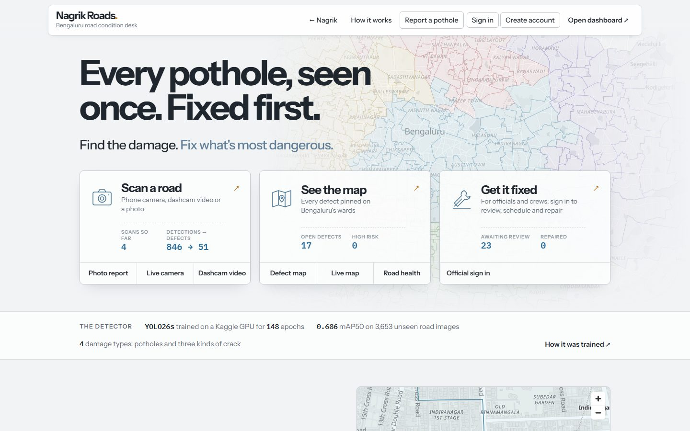
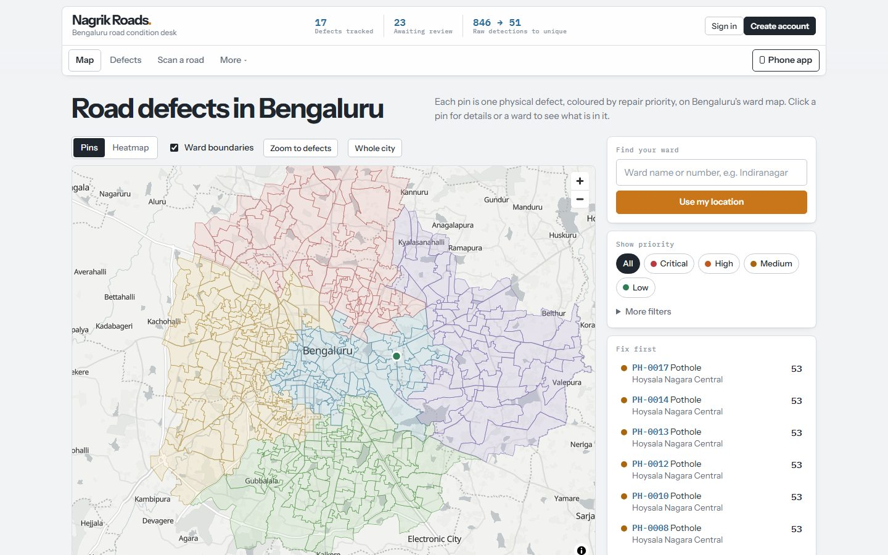
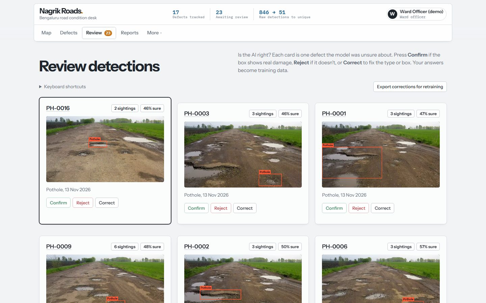
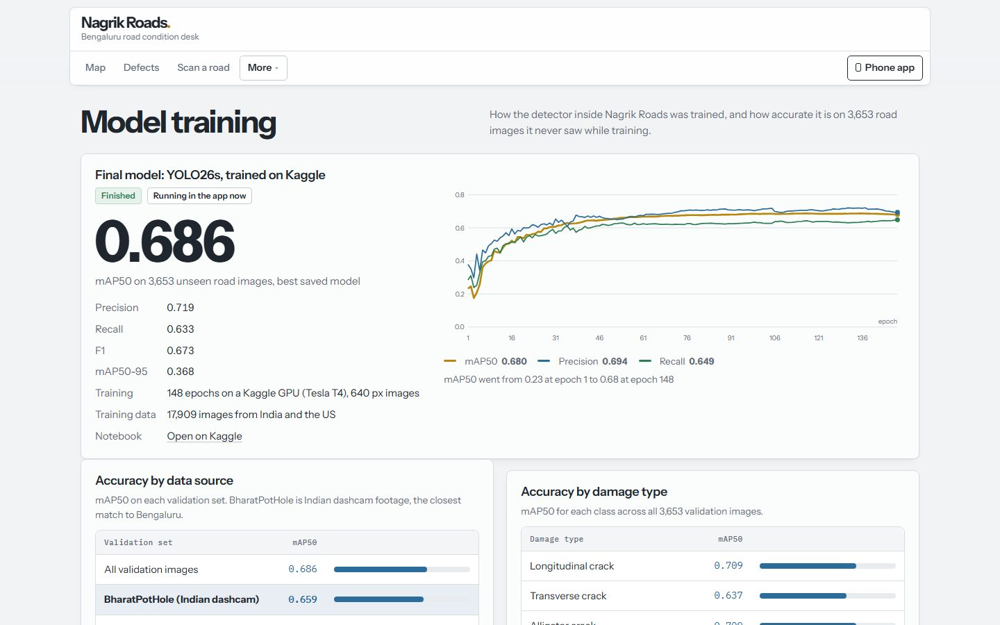
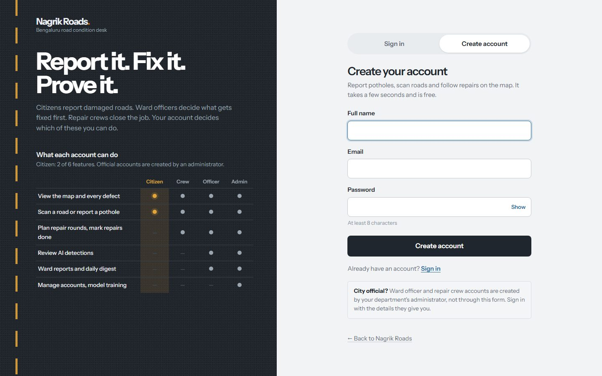
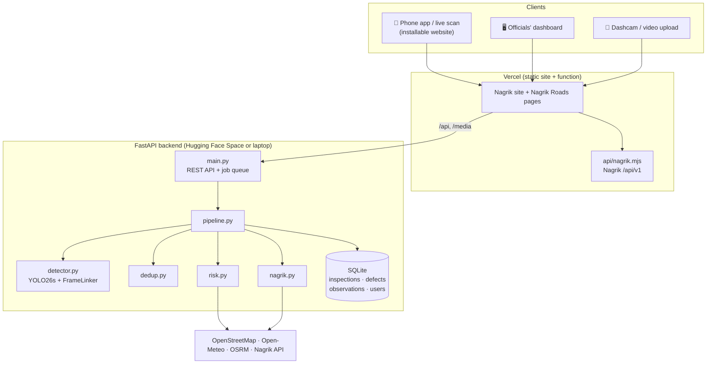

<div align="center">


# Nagrik Roads

### Every pothole, seen once. Fixed first.

AI road-damage detection for Indian cities. A phone or dashcam records the road, the AI finds every pothole and crack,
counts each one once, ranks it by danger and sends it to the ward officer responsible, then checks that the repair
really happened.

**Built for HackValley 2K26 · Problem statement PS 02: AI-Based Road Damage and Pothole Detection System**

  

      

### 🌐 Live demo: **[nagrik-roads.vercel.app/roads](https://nagrik-roads.vercel.app/roads/)**

| | Live link |
|---|---|
| Nagrik Roads (website + phone app) | https://nagrik-roads.vercel.app/roads/ |
| Officials' dashboard and map | https://nagrik-roads.vercel.app/roads/dashboard |
| Live scan (phone camera) | https://nagrik-roads.vercel.app/roads/live |
| Model training results | https://nagrik-roads.vercel.app/roads/training |
| Nagrik city site | https://nagrik-roads.vercel.app/ |
| AI backend (Hugging Face Space) | https://huggingface.co/spaces/ayman43/nagrik-roads-backend |
| API health check | https://nagrik-roads.vercel.app/api/health |

<sub>Website on Vercel · AI backend on Hugging Face · open the Roads link on a phone and tap <b>Install app</b> (iPhone: Share → Add to Home Screen). The free backend sleeps when idle: the first visit can take a minute.</sub>



</div>

---

## Contents

[Why we built this](#why-we-built-this) · [What it does](#what-it-does) · [Try it in 2 minutes](#try-it-in-2-minutes) · [Features](#features) · [Screenshots](#screenshots) · [How it works, step by step](#how-it-works-step-by-step) · [Nagrik and Nagrik Roads](#nagrik-and-nagrik-roads-how-the-two-fit-together) · [Architecture](#architecture) · [Code structure](#code-structure) · [Results](#results) · [PS 02 checklist](#ps-02-checklist) · [Who can do what](#who-can-do-what) · [Run it](#run-it) · [Challenges](#challenges-we-ran-into) · [What's next](#whats-next) · [Research](#research) · [Credits](#data-and-credits)

---

## Why we built this

In 2022, potholes caused **4,446 road accidents in India, killing 1,856 people and injuring 3,734**, up from 1,481
deaths in 2021 (Ministry of Road Transport and Highways, *Road Accidents in India 2022*). Every rider in India knows the
problem first-hand, and four things keep it from being fixed:

- **Potholes are found late.** Cities rely on complaints, so damage on quiet roads goes unreported until it is dangerous.
- **The same pothole is reported again and again.** Ten complaints about one pothole look like ten problems.
- **Nobody knows which one to fix first.** A small crack outside a school matters more than a big one on an empty lane.
- **Bad repairs go unnoticed.** A pothole patched badly is back within weeks, and no record connects the two.

Nagrik Roads turns the phones and dashcams already on the road into a city-wide road survey, and gives the ward
office one clean, ranked list of what to fix.

## What it does

| | |
|---|---|
| 📷 **See** | Any phone or dashcam becomes a road scanner: live from a moving vehicle, from a recorded video, or a single photo |
| 🔍 **Detect** | A YOLO26s model trained on Indian roads finds potholes and three kinds of crack |
| 1️⃣ **Count once** | Each defect is followed across frames: **1,768 per-frame detections become 49 unique potholes** |
| 📍 **Pin and de-duplicate** | GPS puts every defect on the city's ward map (Bengaluru's 369 wards are live today); a repeat report updates the existing pothole instead of creating a new one |
| ⚠️ **Rank by danger** | An explainable 0–100 score: severity, road type, speed limit, nearby schools and hospitals, repeat reports, rain forecast |
| 🏛️ **Send to the right person** | Each defect is linked to its ward, the responsible officer and recent road tenders |
| ✅ **Prove the fix** | Every later drive checks the spot again: worsening, improving or repaired, and a pothole back within 90 days is flagged as a **bad repair** |

## Try it in 2 minutes

1. Open **https://nagrik-roads.vercel.app/roads/** on your phone and tap **Install app**.
2. Tap **Report** and photograph a pothole, or upload a short road video. Watch the progress bar, then see each
   pothole get a code (`PH-0001`…), a severity and a pin on the map.
3. Open the **dashboard**: click a pin to see the photo, the risk score explained factor by factor, the ward and its
   officer, and the "dangerous in about N days" forecast.
4. Upload the **same** video again: the potholes are recognised as already known, not added twice.
5. Open **Live scan** while riding: boxes appear on the camera view and new potholes appear on the live map.
6. Sign in as an officer to **review** what the AI was unsure about, or as a crew to **plan a repair route**.

---

## Features

<table>
<tr>
<td width="50%" valign="top">

### 🙋 For citizens
- **Report a pothole** with one photo; location is added automatically
- **Live scan** while driving: potholes appear on the map as you go
- **Dashcam video upload** with a GPS file (GPX, NMEA, CSV, JSON), or GPS read from inside GoPro / Viofo / 70mai / Garmin / BlackVue videos
- **Phone app** that installs from the browser, no app store needed
- **Map of every defect** with risk colours, heatmap and ward boundaries
- **Track repairs** on each defect: before/after photos and status
- **Printable complaint** for any defect

</td>
<td width="50%" valign="top">

### 🏛️ For ward officers
- **Review queue**: confirm, reject or redraw what the AI was unsure about; corrections export as training data
- **Workflow** for each defect: reported → verified → scheduled → repaired → closed
- **Daily ward digest**: one summary of new, worsening and overdue defects instead of one alert per pothole
- **Defect register** download as CSV
- **Road health by street**: which streets are worst
- **Risk explained factor by factor**, plus a forecast of when a defect becomes dangerous

</td>
</tr>
<tr>
<td valign="top">

### 🚧 For repair crews
- **Repair route planner**: the top defects by risk in the fastest driving order on real roads, with arrival times and a printable crew sheet
- **Mark repaired**, with the crew ID saved for accountability
- **Re-scan after fixing** to prove the repair

</td>
<td valign="top">

### 🔐 For administrators
- **Accounts**: create ward officer and repair crew accounts, change roles, disable access
- **Model training page**: how the detector was trained and how accurate it is
- Citizens sign up themselves; officials get their account from an administrator

</td>
</tr>
</table>

### 🧠 Under the hood
- **YOLO26s detector** trained by us on 17,909 images from Indian and US roads (Kaggle Tesla T4, 148 epochs)
- **Frame linking** counts each defect once, even when a moving vehicle sees it only now and then
- **Three-layer duplicate check**: within 15 m, similar image (perceptual hashes + colour histogram), compatible damage type
- **Privacy by default**: faces and number plates are blurred in every saved photo and video
- **Runs on a laptop CPU** (~135 ms per frame), so a municipal office needs no GPU
- **Free and open services only**: OpenStreetMap, Open-Meteo, OSRM; no paid API, no API keys

---

## Screenshots

<table>
<tr>
<td width="50%"><br><b>Defect map</b>: every pothole on the city's wards (Bengaluru shown), "fix first" list on the right</td>
<td width="50%"><br><b>Defect detail</b>: before/after slider and the risk score explained factor by factor</td>
</tr>
<tr>
<td><br><b>Review queue</b>: officers confirm or correct what the AI was unsure about</td>
<td><br><b>Repair route planner</b>: the crew's round in the fastest driving order</td>
</tr>
<tr>
<td><br><b>Reports</b>: daily ward digest and the full defect register</td>
<td><br><b>Model training</b>: the Kaggle YOLO26s run, live on the website</td>
</tr>
<tr>
<td><br><b>Sign in</b>: what each account can do, shown before you sign up</td>
<td align="center"><br><b>Phone app</b>: report a pothole near you</td>
</tr>
</table>

---

## How it works, step by step



**1. Capture.** Four ways in, all ending in the same pipeline: a photo (GPS from EXIF or the phone), a recorded
video with a GPS track (`capture.html` records one alongside the video), a dashcam file whose GPS is read from inside
the video (`dashcam.py`), or **live scan**, where the phone sends about 3 frames per second with its GPS fix
(`live.py`).

**2. Detect.** Every second frame goes through **YOLO26s**, trained by us on RDD2022 India and US, BharatPotHole
dashcam frames and Kaggle potholes (4 classes: pothole, longitudinal, transverse and alligator crack). The
confidence threshold of 0.20 was chosen by sweeping thresholds for the best F1 on Indian validation images
(`scripts/tune_detector.py`). For uploads, cracks can come from a second, crack-specialised RDD2022 model (F1 on
Indian roads 0.54 → 0.61).

**3. Count each pothole once.** A video sees the same pothole in dozens of frames. `detector.FrameLinker` links
detections into one track per physical defect: it matches by distance (scaled by box size), allows a few missed
frames, and never links a box that jumped clearly *up* the frame, because a pothole only moves towards the vehicle.
A track counts when seen in 2+ analysed frames, or once above 0.5 confidence. We wrote this after ByteTrack, the usual
choice, counted **1** pothole on a 9-second ride over about ten (see [Challenges](#challenges-we-ran-into)).

**4. Locate.** Each defect gets the GPS position of the moment it was seen best: interpolated along the GPS track
for videos (`geo.py`), from EXIF or the phone for photos.

**5. Severity.** `severity.py` scores 0–100 from the damage type (pothole 1.0, alligator crack 0.8, transverse 0.55,
longitudinal 0.45) × the visible size, corrected for perspective (defects near the top of the frame are farther away
and look smaller). An optional Depth Anything V2 depth index adds how deep the defect is. Labels: Low < 35 ≤ Medium < 60 ≤ High.

**6. De-duplicate.** `dedup.py` asks "is this a pothole we already know?" in three layers: candidates within
**15 m**, then **image similarity** of the crops (perceptual hash, difference hash, grey thumbnail correlation and
colour histogram), then a **compatible class**. Within 5 m a moderate similarity (≥ 0.45) is enough; at 5–15 m it
must be clearly similar (≥ 0.60); with no GPS only a near-identical image (≥ 0.92) matches. A match adds a sighting to
the existing defect and raises its report count instead of creating a new record.

**7. Rank by risk.** `risk.py` adds up points you can read on every defect page:

| Factor | Max points | Source |
|---|:---:|---|
| Severity (× damage-type factor) | 40 | step 5 |
| Road class (motorway … residential) | 15 | OpenStreetMap |
| Speed limit (20 → 80 km/h) | 10 | OpenStreetMap or road-class default |
| Schools, hospitals, bus stops within 300 m | 10 | OpenStreetMap |
| Repeat reports (log scale) | 10 | step 6 |
| Rain in the next 72 h (0 → 30 mm) | 10 | Open-Meteo |
| Getting worse since last scan | 5 | step 9 |
| Came back within 90 days of a repair | 5 | step 9 |

Score ≥ 75 Critical, ≥ 55 High, ≥ 35 Medium. A forecast estimates **days until High severity** from how fast the
defect grew between scans (growth × 1.5 when heavy rain is coming).

**8. Send to the right person.** `nagrik.py` finds the ward, corporation and officials for the defect's location, and
recent road tenders in that ward, from the Nagrik public API ([next section](#nagrik-and-nagrik-roads-how-the-two-fit-together)).
Officers get one daily digest per ward, and every defect has a printable complaint.

**9. Verify, repair, re-check.** Officers confirm, reject or correct uncertain detections (corrections export as
YOLO training data). Crews get a route over the worst defects (OSRM), mark repairs with their crew ID, and the next
scan of that road decides: still there (worsening / improving), **possibly repaired** (missing once), **repaired**
(missing twice), or a **bad repair** (back within 90 days).

**Privacy.** Before any frame is stored or shown, `privacy.py` blurs faces and number plates found by a COCO-trained
detector. Detection runs on the original frame, so blurring never hides a pothole.

---

## Nagrik and Nagrik Roads: how the two fit together

### What Nagrik is

**[Nagrik](https://nagrik.in.net/)** ("citizen") is an independent civic-data platform created by **Vyom Bhatnagar**.
Its idea: *know who is responsible, know what was promised, check the public record, raise the question.* It
gathers civic records that governments already publish but scatter across many portals, and puts them in one
place, city by city. It covers much more than roads:

| Nagrik feature | What it gives a citizen |
|---|---|
| **5 cities** | Bengaluru, Delhi, Gurugram, Mumbai and Pune, each with its own overview, works, people and sources pages |
| **Find your ward** | Type a locality and get its ward, ward number and city corporation, on a ward map |
| **Who runs the city** | Elected councillors (or the administrator where there is no sitting council), every civic body, and a directory of officials with department and contact, plus helplines |
| **Money and public works** | Every public works tender and awarded contract: value, agency, status and contractor, with charts by agency and by status ("follow the money") |
| **News and elections** | Civic news for the city, and what voters need to know before civic elections |
| **Sources** | Every record links to its official source (for example the Karnataka Public Procurement Portal) and shows when it was read |
| **AI assistants** | A read-only MCP server, so ChatGPT, Claude or Grok can answer questions like *"Which ward governs this locality?"* or *"Who do I contact about drainage in my ward?"*, with no account or API key |
| **Public API** | `/api/v1`: cities, wards and ward boundaries, people, projects and "resolve this point to a ward" |

For Bengaluru alone (snapshot of 13 Nov 2026): **369 wards** in 5 new city corporations (Central, East, North, South,
West), **926 officials** across **15 agencies**, and **4,974 public works** worth **₹6,156 crore tendered**
(₹1,448 crore awarded). Nagrik is not an official government website; it republishes public records with their sources.

### What Nagrik Roads adds

Nagrik shows **what was paid for**. Nagrik Roads shows **what the road actually looks like**. Put together, they
answer not only *where* a pothole is, but *who must fix it* and *whether money was already spent on that road*.

| Nagrik provides | Nagrik Roads uses it for |
|---|---|
| Ward boundaries (GeoJSON) | The ward map on every page, and "You're in Ward 25 · Ashokanagar" in the app |
| Ward, corporation and officials for a point | The officer shown on each defect, in its complaint and in the ward digest |
| Road works and tenders per ward | "Recent road tenders in this ward" on each defect: a pothole beside a recently paid road job stands out |

And Nagrik gains a layer it did not have: live road condition, rated defect by defect, with a repair history.

### How they run as one application

- **Locally** (`start.cmd`): Nagrik's Node server (`nagrik/backend/server.mjs`, port 5501) serves the Nagrik site and
  forwards `/roads`, `/api`, `/media` and `/eval` to the Nagrik Roads backend (FastAPI, port 8000). One address,
  one sign-in. `nagrik-roads-link.js` adds the Roads entry points to Nagrik's pages.
- **Online**: Vercel serves both sites as static files, runs Nagrik's `/api/v1` as a function (`api/nagrik.mjs`,
  same server code), and forwards the Roads API to the backend on Hugging Face.
- All Nagrik responses are cached (`backend/data/cache/`), so the map and ward lookup keep working offline.

---

## Architecture



```mermaid
flowchart LR
    A["📷 Phone, dashcam<br>or photo"] --> B["🔍 YOLO26s<br>detects damage"]
    B --> C["1️⃣ Frame linking<br>counts each once"]
    C --> D["📍 GPS + duplicate check<br>new or already known?"]
    D --> E["⚠️ Risk score<br>road, schools, rain"]
    E --> F["🏛️ Ward officer<br>reviews and schedules"]
    F --> G["🚧 Crew repairs<br>on a planned route"]
    G --> H["✅ Next scan checks<br>the repair"]
    H -. "back within 90 days" .-> I["🚩 Bad repair"]
```

| Layer | Built with |
|---|---|
| Detection | Ultralytics YOLO26s (trained by us), `detector.FrameLinker`, OpenCV |
| Backend | Python 3.12, FastAPI, SQLite (MongoDB-ready accounts store), background job queue |
| Web | Plain HTML/CSS/JS (no build step), MapLibre GL (maps), Leaflet (route planner, road health), installable PWA |
| Civic site | Nagrik, Node 20 server that also forwards `/roads` to the backend |
| Context data | OpenStreetMap Overpass, Open-Meteo, OSRM, Nagrik ward and tender data |
| Hosting | Vercel (website), Hugging Face Space (backend); or everything on one laptop |

Every external call has a timeout, a cache and a fallback, so a slow or offline service never breaks a scan.
Full design: [`roads/docs/ARCHITECTURE.md`](roads/docs/ARCHITECTURE.md).

---

## Code structure

```
├── start.cmd, start.mjs           one command starts the backend (8000) and the Nagrik site (5501)
├── vercel.json, deploy/, api/     online deployment: static build, Nagrik API function, backend forwarding
├── nagrik/                        Nagrik civic-data site (backend/server.mjs serves it and forwards /roads)
└── roads/                         Nagrik Roads
    ├── backend/app/
    │   ├── main.py                FastAPI app: upload endpoint, job queue, stats, metrics, serves frontend/
    │   ├── pipeline.py            one inspection end to end (steps 1–9 above)
    │   ├── detector.py            YOLO models, photo detection, video counting (FrameLinker), drawing
    │   ├── severity.py            severity score from damage type, size, perspective, optional depth
    │   ├── privacy.py             face and number-plate blurring
    │   ├── geo.py, dashcam.py     EXIF, GPS track files, GPS embedded in dashcam videos
    │   ├── dedup.py               image fingerprints, duplicate matching, trend, repaired / bad repair
    │   ├── risk.py                road context, weather, risk score, forecast
    │   ├── nagrik.py              ward, officials and tenders from Nagrik
    │   ├── review.py              officer review queue, workflow, corrections export
    │   ├── reports.py             complaint, ward digest, CSV register
    │   ├── crew.py, roads.py      repair route planner, road health by street
    │   ├── live.py                live scan sessions
    │   ├── auth.py, auth_store.py sign-up, sign-in, roles, server-side access rules, rate limits
    │   └── db.py                  SQLite schema
    ├── backend/tests/             72 tests: pipeline end to end, dedup, risk, review, roads, crew, privacy, dashcam
    ├── backend/models/            roadsense_y26s.pt (our trained detector) + metrics
    ├── frontend/
    │   ├── home.html              website and phone app: report, near you, how it works
    │   ├── index.html, app.js     officials' dashboard: map, defects, detail, upload, review, reports, metrics
    │   ├── live.html, livemap.html  live scan and its live map
    │   ├── capture.html/.js       record a ride with GPS track and bump sensor
    │   ├── route.html/.js, roads.html/.js  repair route planner, road health
    │   ├── training.html          how the model was trained
    │   ├── login.html, users.html, gate.js  accounts and per-role page access
    │   ├── rsmap.js, styles.css   shared map and design system
    │   └── manifest.webmanifest, sw.js  installable phone app
    ├── scripts/                   dataset building, training (laptop + Kaggle), tuning, evaluation (see scripts/README.md)
    ├── dataset/                   splits, class counts, 20 labelled samples, sample video, licences
    └── docs/                      architecture, references, research, results, screenshots
```

**Life of a request: uploading a road video**

1. The browser posts the file to `POST /api/inspections` (`main.create_inspection`). The file is saved under
   `backend/data/uploads/<id>/`, an inspection row is created, and a job is queued. The browser gets a `job_id` at once.
2. A background worker runs `pipeline.process_inspection`: it loads the GPS track (`geo.load_track`, or
   `dashcam.extract_embedded_track`), then calls `detector.track_video`, which detects every second frame, links
   detections with `FrameLinker`, blurs faces and plates (`privacy.redact`) and writes the annotated video.
3. For each unique defect, `pipeline._record` scores severity, fingerprints the crop, asks `dedup.match_defect`
   whether it is already known, and inserts or updates the defect and its observation.
4. `pipeline._enrich` adds the risk score and forecast (`risk.py`) and the ward, officials and tenders (`nagrik.py`);
   `dedup.update_progress` and `dedup.mark_absent` update trends and "possibly repaired".
5. The browser polls `GET /api/jobs/{job_id}` for progress, then shows the defects found and pins them on the map.

**Code quality**: type hints and docstrings throughout, all thresholds as named constants at the top of each module,
optional modules imported defensively so a failing add-on never takes the core API down, server-side access rules
for every official action, `ruff` lint clean, and 72 tests that each use a temporary database.

---

## Results

| | |
|---|---|
| **Detector** | YOLO26s, trained on a Kaggle Tesla T4 GPU for 148 epochs |
| **Accuracy** | **mAP50 0.686** on 3,653 road images it never saw (precision 0.72, recall 0.63) |
| **Indian dashcam potholes** | **F1 0.68**, up from **0.03** with an off-the-shelf RDD2022 model |
| **Counting once** | 1,768 per-frame detections in a 15 s video become **49 unique potholes**; a 9 s bike ride over ~10 potholes counts 8 potholes + 2 cracks |
| **Speed** | ~135 ms per frame on a laptop CPU, fast enough for live scanning |

**How it improved** (F1 on Indian validation images, higher is better):

| Model | Indian dashcam potholes | Indian roads, all 4 damage types |
|---|:---:|:---:|
| Off-the-shelf RDD2022 YOLOv8s (starting point) | 0.03 | 0.65\* |
| Our YOLO26n, laptop GPU, 29 epochs | 0.49 | 0.50 |
| **Our YOLO26s, Kaggle T4, 148 epochs** | **0.68** | **0.54** |
| YOLO26s + RDD2022 crack model (used for uploads) | 0.67 | 0.61 |

<sub>\* The off-the-shelf model was trained on RDD2022 challenge data that very likely includes these images, so that score is optimistic.</sub>

<table>
<tr>
<td width="50%"><br>What the model finds on validation images</td>
<td width="50%"><br>Losses fall and accuracy rises over 148 epochs</td>
</tr>
</table>

Full numbers, confusion matrix and curves: **[`roads/docs/results/RESULTS.md`](roads/docs/results/RESULTS.md)**.
The same results are on the website at `/roads/training`.

---

## PS 02 checklist

| Requirement | Status | Where |
|---|:---:|---|
| Upload road images or video clips | ✅ | Website and phone app, dashboard *Scan a road*, live scan → `POST /api/inspections` |
| Detect potholes and other damage | ✅ | YOLO26s, 4 classes: pothole, longitudinal, transverse, alligator crack (`detector.py`) |
| Display bounding boxes | ✅ | Annotated photos and videos, live boxes on the camera view, boxes in the review queue |
| Classify severity | ✅ | Low / Medium / High from damage type × size × perspective, optional depth estimate (`severity.py`) |
| Capture location metadata | ✅ | Photo EXIF, GPS track per video frame, live phone GPS, GPS inside dashcam files (`geo.py`, `dashcam.py`) |
| Generate reports | ✅ | Printable complaint, daily ward digest, CSV register (`reports.py`) |
| Show defect counts and categories | ✅ | Header stats, dashboard summary, `GET /api/stats` |
| Dashboard of analysed samples | ✅ | Map, defects, defect detail, reports, model accuracy |
| **Unique pothole tracking** | ✅ | `FrameLinker` across frames (tolerates missed frames from a moving vehicle), class by confidence vote |
| **Duplicate report detection** | ✅ | GPS ≤ 15 m + image similarity + class check (`dedup.py`) |
| **Risk prediction** | ✅ | Explainable 0–100 score + "dangerous in about N days" forecast (`risk.py`) |
| **Manual verification and correction** | ✅ | Review queue: confirm, reject, change type, redraw box (`review.py`) |
| **Progress monitoring** | ✅ | Timeline per defect: worsening / improving / repaired, bad-repair flag (`dedup.py`) |
| Precision, recall, F1, mAP | ✅ | [`RESULTS.md`](roads/docs/results/RESULTS.md), `scripts/compare_models.py`, Model training page |

Requirement-by-requirement detail with file references: [`roads/README.md`](roads/README.md).

---

## Who can do what

| Feature | Visitor | Citizen | Repair crew | Ward officer | Admin |
|---|:---:|:---:|:---:|:---:|:---:|
| See the map, defects and model results | ✅ | ✅ | ✅ | ✅ | ✅ |
| Scan a road, report a pothole, phone app | ✅ | ✅ | ✅ | | |
| Plan repair rounds, mark repairs done | | | ✅ | ✅ | ✅ |
| Review AI detections, reports, digest | | | | ✅ | ✅ |
| Manage accounts | | | | | ✅ |

Anyone can create a citizen account. Ward officer and repair crew accounts are created by an administrator.
Every official-only action is checked by the server, so hiding a button is never the only protection.

---

## Run it

**You need:** Python 3.12 and Node 20+. Everything runs on a laptop CPU.

```powershell
# one-time set-up
cd roads
python -m venv .venv
.venv\Scripts\pip install -r requirements.txt
cd ..

# start everything, then open http://localhost:5501/roads/
start.cmd
```

`start.cmd` starts the Nagrik Roads backend (FastAPI on port 8000) and the Nagrik site (Node on port 5501) together.
To scan from a phone on the same Wi-Fi, run `set HOST=0.0.0.0` before `start.cmd`.

| Address | Page |
|---|---|
| `/roads/` | Website and phone app |
| `/roads/dashboard` | Map, defects, review, reports |
| `/roads/live` | Live scan |
| `/roads/login` | Sign in / create account |
| `/roads/training` | Model training and accuracy |

**Tests and checks** (from `roads/`): `.venv\Scripts\python.exe -m pytest backend/tests` runs 72 tests (live-service
checks skip when offline), and `.venv\Scripts\python.exe -m ruff check .` passes clean. Every test file also runs on
its own, e.g. `python backend/tests/test_pipeline.py`.

On first start, demo **admin**, **officer** and **crew** accounts are created with random passwords, saved to
`roads/backend/data/demo_accounts.txt` (never committed). The trained model `roads/backend/models/roadsense_y26s.pt`
is included.

---

## Challenges we ran into

- **Off-the-shelf models were blind on Indian roads.** A public RDD2022 model scored **F1 0.03** on Indian dashcam
  potholes. We built a combined dataset with Indian images (RDD India, BharatPotHole) and trained our own detector.
- **Our laptop could not finish training.** The YOLO26n run was killed by memory pressure in its last epoch. We moved
  training to a Kaggle T4 notebook and trained a larger YOLO26s for 148 epochs (F1 0.49 → 0.68 on Indian dashcam potholes).
- **The standard tracker missed almost every pothole on a real ride.** ByteTrack keeps a new track only if the object
  is detected again in the very next frame with overlapping boxes. From a moving bike, small potholes jump between
  frames and flicker in and out, so a 9-second ride over about ten potholes counted **1**. We wrote `FrameLinker`,
  which links by distance, tolerates missed frames and uses the fact that potholes move down the frame: the same ride
  now counts 8 potholes and 2 cracks, each checked by eye.
- **Videos without GPS merged different potholes.** With no GPS track, every pothole in a clip shares one location,
  and similar-looking asphalt made the duplicate check join them. Merging within one video now needs a GPS track.
- **Free hosting fought back.** The free Hugging Face hardware only accepts Gradio apps, and Vercel's proxy rejects
  large uploads. We wrapped the FastAPI backend so it runs unchanged on the Space, and big videos go straight to it.
- **Public map services are slow.** Overpass lookups sometimes took 20 s. Every lookup is now cached by location,
  and a failed one is remembered for 10 minutes, so a scan never waits on it twice.

## What we're proud of

- A complete loop, not just a detector: **detect → count once → de-duplicate → rank → assign → repair → verify**.
- An honest model: trained by us, measured on images it never saw, compared against public baselines, and every
  number reproducible with the scripts in `roads/scripts/`.
- Risk you can explain to a citizen or an auditor: every point of every score is listed with its reason.
- Privacy by default, no paid services, and it runs on a laptop CPU.

## What we learned

- Benchmark scores do not transfer between countries; collecting the right data mattered more than the model size.
- A tracker tuned for pedestrians fails on potholes seen from a bike; test on real footage early.
- Location is what turns detections into a public record; without it, de-duplication and repair checks are guesswork.

## What's next

- **Learn from officers:** retrain on the corrections exported from the review queue and on rides collected through the app.
- **Offline live scan:** run the detector in the browser, so live scan works with no connection.
- **Contractor accountability:** link bad repairs to the tender and contractor that did the work, using Nagrik's tender data.
- **Belagavi and more cities:** the detector and pipeline already work on any Indian road; a new city needs only its
  ward map and officials, which is exactly what Nagrik collects. Delhi, Mumbai, Pune and Gurugram are already in Nagrik,
  and Belagavi, where we built this, is the next city we want to add.
- **Into the city's workflow:** send verified defects straight into the municipal complaint system.

---

## Research

The design follows published work on smartphone road-damage detection, tracking-by-detection and perceptual
hashing. **[`roads/docs/REFERENCES.md`](roads/docs/REFERENCES.md)** lists 19 papers and tools and where each is
used in the code, including why we replaced ByteTrack with our own frame linker. Similar projects we studied:
[`roads/docs/RESEARCH.md`](roads/docs/RESEARCH.md). Architecture: [`roads/docs/ARCHITECTURE.md`](roads/docs/ARCHITECTURE.md).

Key papers: YOLO (Redmon et al., CVPR 2016) · RDD2022 (Arya et al., 2022) · smartphone road damage detection
(Maeda et al., 2018) · cross-country transfer (Arya et al., 2021) · SORT (Bewley et al., 2016) and ByteTrack
(Zhang et al., ECCV 2022) · Pothole Patrol (Eriksson et al., MobiSys 2008) and Nericell (Mohan et al., SenSys 2008) ·
perceptual hashing (Zauner, 2010) · Depth Anything V2 (Yang et al., NeurIPS 2024).

## Data and credits

- **Accident statistics:** Ministry of Road Transport and Highways, Government of India, *Road Accidents in India 2022*
- **Training data:** RDD2022 India and United States (CC BY-SA 4.0), BharatPotHole (CC BY 4.0), Kaggle Potholes (CC0)
- **Models:** Ultralytics YOLO (AGPL-3.0), our YOLO26s trained on the data above; RDD2022 YOLOv8s crack model (optional)
- **Maps:** OpenFreeMap and OpenStreetMap contributors (ODbL); ward boundaries from Nagrik
- **Context data:** OpenStreetMap Overpass, Open-Meteo, OSRM
- **Ideas from other projects (our own code):** road-health colouring (iWatchRoad), repair route planner and training
  recipe starting point (Pothole Pilot, used only as a baseline). Details in [`roads/README.md`](roads/README.md#credits-and-licences).

<div align="center">
<br>
<b>Nagrik Roads</b> · built for <b>HackValley 2K26</b> · Belagavi
</div>
